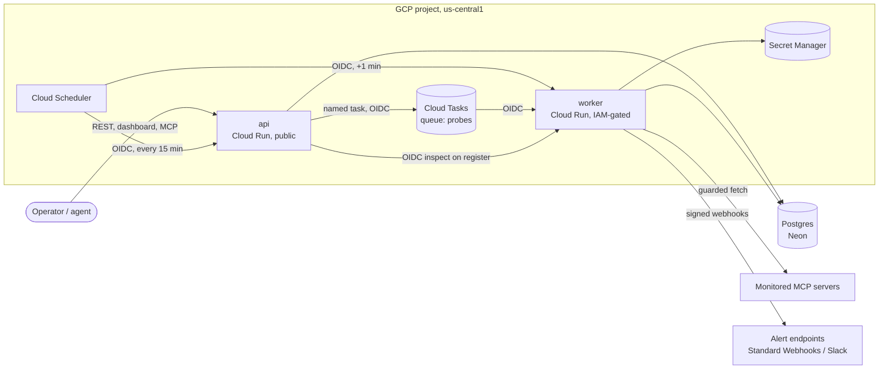
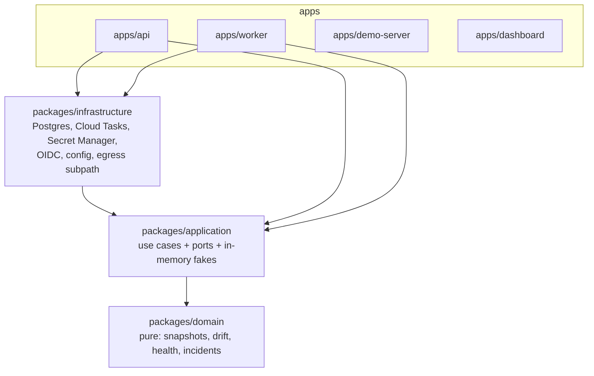
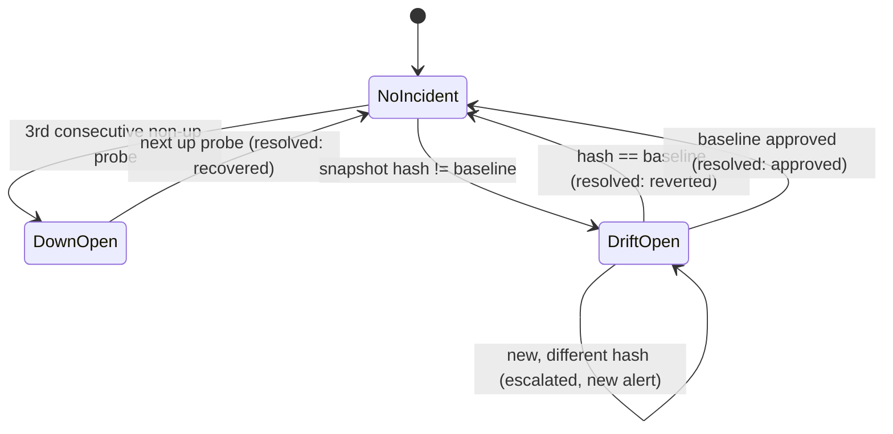

# Keelson architecture

Keelson watches remote MCP servers and tells you when they break or change under you. This document explains how it is built and why. Decision records with the alternatives considered live in [`decisions/`](decisions/).

- [1. Problem and requirements](#1-problem-and-requirements)
- [2. Sizing](#2-sizing)
- [3. System context](#3-system-context)
- [4. Code structure](#4-code-structure)
- [5. The probe pipeline](#5-the-probe-pipeline)
- [6. Domain model](#6-domain-model)
- [7. Data model](#7-data-model)
- [8. Interfaces](#8-interfaces)
- [9. Correctness under retries](#9-correctness-under-retries)
- [10. Failure modes](#10-failure-modes)
- [11. Security](#11-security)
- [12. Deployment and operations](#12-deployment-and-operations)
- [13. Testing](#13-testing)
- [14. Limits and the scaling path](#14-limits-and-the-scaling-path)
- [15. Known limitations](#15-known-limitations)

---

## 1. Problem and requirements

Teams let AI agents call MCP servers they do not control. Such a server can go down, drop a tool, rename a parameter, or change a tool's description after a human approved it: a **rug pull**, because the description is injected into the agent's context and can carry new instructions.

**Functional**
1. Register a remote MCP server (Streamable HTTP) as a **monitor**.
2. Probe it on a schedule: handshake, list tools, prompts and resources. Never call a tool.
3. Store what it serves as a content-addressed **snapshot** and compare it with an approved **baseline**.
4. Classify every difference (**drift**) by severity; a changed tool description is always critical.
5. Open at most one **incident** per monitor and kind (`down`, `drift`), and alert once per state change.
6. Let a human review the drift and approve a new baseline.
7. Expose all of it through a REST API, a dashboard, and Keelson's own read-only MCP server.

**Non-functional**
- Every step is safe to retry; correctness never depends on something running exactly once.
- Probing untrusted hosts must not expose internal networks (SSRF), and untrusted text is shown as data, never executed or rendered as markup.
- Polite to the servers it watches: list-only, identifying `User-Agent`, bounded frequency ([`docs/probes.md`](../probes.md)).
- Near-zero cost at idle; everything deployed as code.

## 2. Sizing

| Quantity | Value | Basis |
|---|---|---|
| Probe interval | 15 min effective (300 s accepted by the API, dispatch runs every 15 min) | `infra/scheduler.ts`, ADR 0007 |
| Probes per monitor per day | 96 | 24 × 4 |
| Requests per probe | 4-6 HTTP requests (initialize, initialized, up to 3 list calls, pages) | MCP lifecycle |
| Probe duration | under 10 s by budget; typically a few hundred ms | `PROBE_BUDGET_MS` |
| Response size | at most 4 MiB per HTTP response; a large real tools page is a few hundred KB | `MAX_RESPONSE_BYTES` |
| Rows written per probe | 1 probe row; snapshot only when the catalog changes; incident/outbox only on a state change | content addressing |
| Capacity as deployed | 500 monitors per dispatch run (batch limit), 4,500 tasks per 15 min at the queue's 5/s | section 14 |

## 3. System context



- **api**: public Fastify service. `/v1` REST (OpenAPI-first), the dashboard (Vue SPA), `/mcp` (Keelson's MCP server), `/reference` (API reference), and `/internal/dispatch`. It never dials an untrusted host.
- **worker**: private Fastify service, reachable only by three service accounts. It is the only process that talks to monitored servers and alert endpoints.
- **demo-server**: an MCP server whose tool description can be changed on purpose, for end-to-end tests and demonstrations.
- **Postgres** holds all state. Secrets (monitor bearer tokens, webhook signing keys) live in Secret Manager; the database stores references only.

## 4. Code structure

An onion in an npm-workspaces TypeScript monorepo. Dependencies point inward, and CI enforces it.



| Layer | Holds | May import |
|---|---|---|
| `packages/domain` | entities and value objects, canonicalisation and hashing, drift and JSON Schema classification, health assessment, incident transitions | itself and `node:crypto` only |
| `packages/application` | use cases (`DispatchDueProbes`, `RunProbe`, `DrainOutbox`, `ApproveBaseline`, ...), ports, read queries, in-memory adapters for tests | domain |
| `packages/infrastructure` | adapters for every port; network code exported only through the `@keelson/infrastructure/egress` subpath | domain, application |
| `apps/*` | composition roots (awilix), HTTP routes, process entry points | packages |

**Enforcement.** Seven dependency-cruiser rules run in CI (`.dependency-cruiser.cjs`): the domain is pure, application depends on domain only, infrastructure never imports apps, **the api may not import egress code**, DI containers exist only in composition roots, the shared MCP HTTP package is app-only, and there are no cycles. `scripts/dependency-rule.test.sh` proves four of the rules fail when violated. See ADR 0004.

## 5. The probe pipeline

```mermaid
sequenceDiagram
  participant S as Cloud Scheduler
  participant A as api /internal/dispatch
  participant Q as Cloud Tasks
  participant W as worker /internal/probe
  participant M as MCP server
  participant DB as Postgres
  S->>A: POST (OIDC), every 15 min
  A->>DB: BEGIN; SELECT due monitors FOR UPDATE SKIP LOCKED LIMIT 500
  A->>Q: create task probe-{monitorId}-{slot} (ALREADY_EXISTS = success)
  A->>DB: advance next_probe_at; COMMIT
  Q->>W: POST (OIDC), at-least-once, 5 attempts
  W->>DB: read monitor (no lock held during network I/O)
  W->>M: initialize, list tools/prompts/resources (10 s budget, guarded fetch)
  W->>W: canonicalise, sha256, assess
  W->>DB: BEGIN; lock monitor; INSERT probe ON CONFLICT (monitor_id, slot) DO NOTHING
  W->>DB: snapshot, drift, incident, outbox rows; COMMIT
  S->>W: POST /internal/outbox/drain (OIDC), +1 min
  W->>DB: claim due outbox rows FOR UPDATE SKIP LOCKED, 5-min lease
  W-->>W: deliver signed webhook (webhook-id = idempotency key), mark sent or back off
```

1. **Dispatch** claims due monitors with `FOR UPDATE SKIP LOCKED`, computes the slot `floor(now / interval)`, enqueues one Cloud Task per monitor named after the slot, and moves `next_probe_at` to the next slot, all in one transaction.
2. **Probe**: the worker reads the monitor without holding a lock, inspects the server through the guarded fetch, and turns the result into an outcome: `up`, `timeout`, `connection_error`, `protocol_error` or `auth_error`. A failing server is data, not an error: the task returns 204.
3. **Record**: in one transaction the worker locks the monitor, inserts the probe (unique per slot), saves the snapshot if its hash is new, applies the health assessment (baseline, drift, down, recovery, revert), and writes outbox rows for any alert.
4. **Deliver**: the drain claims due outbox rows with a lease, sends them outside any transaction, and records success or schedules a retry with backoff. Endpoints that fail 10 times in a row are disabled.

## 6. Domain model

**Snapshot.** A server's catalog reduced to the fields Keelson watches: tool `{name, description, inputSchema}`, prompt `{name, description}`, resource `{uri}`. Lists are sorted by identity in UTF-16 code-unit order (locale-independent), object keys are sorted recursively, `required` and `enum` are treated as sets, missing descriptions become `''`. The snapshot hash is `sha256` of the canonical JSON. Server name and version are not hashed: a version bump with an identical catalog is not drift.

**Drift** is the list of changes between the baseline and a new snapshot:

| Change | Severity |
|---|---|
| `tool_removed`, `prompt_removed`, `resource_removed` | critical |
| `description_changed` (tool or prompt) | critical (the rug-pull signal) |
| `input_schema_changed`, breaking | critical |
| `tool_added`, `prompt_added`, `resource_added` | warning |
| `input_schema_changed`, compatible | warning |

**JSON Schema classification** (`drift/schema-change.ts`) is a deny-by-default walk: identical → unchanged; `description`, `title`, `default`, `examples` → compatible; a new optional property → compatible; a removed property → breaking; `enum` with a value removed → breaking, with values only added → compatible; recurse into `properties` and `items`; **any other keyword change is breaking**, so an unfamiliar keyword can never hide a rug pull. Dropping a `required` entry is also treated as breaking (conservative).

**Health and incidents.** `assessProbe` is a pure function returning effects that the application layer applies:



The first successful probe of a new monitor becomes its baseline (trust on first use). Acknowledging an incident is orthogonal to its state. A resolved incident never reopens; a recurrence opens a new one.

## 7. Data model

| Table | Purpose | Key constraints |
|---|---|---|
| `tenants`, `api_keys` | tenancy and auth | `api_keys.key_hash` unique (SHA-256 of a 256-bit key) |
| `monitors` | watched servers, schedule, baseline | `interval_seconds >= 300`; partial index on `next_probe_at` where active |
| `probes` | one row per monitor per slot | **unique `(monitor_id, slot)`**; index `(monitor_id, started_at desc)` |
| `snapshots` | canonical catalogs | **primary key `hash`** (content-addressed, shared across tenants, read only through a tenant's monitors) |
| `drifts` | changes between two hashes | |
| `incidents` | open/resolved problems | **partial unique `(monitor_id, kind) where state = 'open'`** |
| `webhook_endpoints` | alert destinations | `format in ('standard','slack')` |
| `outbox` | alerts to deliver | **unique `idempotency_key`**; partial index on `next_attempt_at` where unsent |

Deleting a monitor cascades to its probes, drifts, incidents and pending alerts. Migrations are versioned SQL run by a Cloud Run job.

## 8. Interfaces

- **REST** `/v1` (19 operations): monitors (CRUD, health counts, stats, probes, snapshots, drift, approve baseline), incidents (list, counts, acknowledge), webhook endpoints (CRUD). The OpenAPI 3.1 document is the source of truth: routes are bound by `operationId`, requests validated (unknown fields refused), responses serialised from the schema so internal fields cannot leak, errors are RFC 9457 problem details, pagination is keyset with an opaque cursor. Served at `/openapi.yaml` with an interactive reference at `/reference`.
- **MCP** `POST /mcp` (API key): `list_monitors`, `get_drift`, `list_open_incidents`, all read-only. `get_drift` returns drift verbatim with an explicit untrusted-content label.
- **Alerts**: [Standard Webhooks](https://www.standardwebhooks.com/) (`webhook-id`, `webhook-timestamp`, `webhook-signature`) or Slack incoming-webhook format. Events: `incident.opened`, `incident.escalated`, `incident.resolved`.
- **Dashboard**: overview, monitors, monitor detail (drift diff, probe history, snapshot, settings), incidents, webhooks. Types generated from the OpenAPI document; CI fails if they are stale.

## 9. Correctness under retries

Every hop is at-least-once. Five mechanisms make duplicates harmless:

| Hop | Duplicate source | Mechanism |
|---|---|---|
| Dispatch → queue | scheduler retry, a second dispatcher, a commit that failed after enqueue | Cloud Task name `probe-{monitorId}-{slot}`; `ALREADY_EXISTS` is success. `SKIP LOCKED` keeps two dispatchers apart |
| Queue → worker | Cloud Tasks redelivery | `probes` unique `(monitor_id, slot)`; a losing insert returns before touching anything else |
| Probe → snapshot | the same catalog every probe | content-addressed `snapshots`, `ON CONFLICT (hash) DO NOTHING` |
| Probe → incident | concurrent probes, retries | monitor row lock + partial unique index on open incidents |
| Incident → alert | crash between send and mark-sent | transactional outbox; stable `webhook-id` per message so receivers dedupe |

## 10. Failure modes

| Failure | Behaviour | Recovery |
|---|---|---|
| Monitored server down, slow, not MCP, malformed catalog | recorded as the probe outcome | 3 in a row open `down`; next `up` resolves |
| Server never ends pagination | stops at 50 pages → `protocol_error` | next probe |
| Keelson dependency fails (DB, Secret Manager) in the worker | 500 → Cloud Tasks retries 5 times (10 s to 300 s) | last attempt logs `probe.retries_exhausted` → email alert |
| Dispatch fails | transaction rolls back; tasks already created run harmlessly | next run 15 min later; the missed slot is a gap |
| Alert endpoint fails | stays pending, backoff 1, 2, 4 … 60 min (applied at each drain) | disabled after 10 consecutive failures; re-enable via API |
| Worker dies after sending, before marking sent | message re-claimed after the 5-min lease, same `webhook-id` | receiver dedupes |
| Monitor deleted or paused while queued | probe writes nothing | n/a |
| Process shutdown | SIGTERM closes the server, then the pool and clients | Cloud Run restarts on demand |

## 11. Security

- **SSRF guard** (worker only, every probe and webhook delivery): resolves the host once, requires every address to be public, and connects to the checked address from the same lookup, so a rebinding DNS answer cannot slip in. Private, loopback, CGNAT, documentation, multicast and reserved ranges are refused for IPv4 and IPv6, IPv4-mapped IPv6 is judged by its IPv4 address, and **link-local (including `169.254.169.254`) is refused even in local development**. Redirects are followed manually, at most 5, each hop re-checked, credentials dropped across origins. Webhook deliveries never follow redirects. Every response body is capped at 4 MiB: a declared length above it is refused before reading, and a stream that grows past it errors instead of being truncated, so a hostile server cannot exhaust worker memory inside the 10 s budget.
- **Service-to-service auth**: Google OIDC ID tokens with audience and allow-listed service-account checks in the application, on top of Cloud Run IAM for the worker. Static tokens exist only for local runs, and the default mode is OIDC.
- **Least privilege**: one service account per role; the CI deployer has no IAM admin rights (identities and roles live in a bootstrap stack applied by a person); pull-request previews run as a read-only identity; secrets are scoped by name prefix.
- **Secrets**: never stored in the database or Pulumi state; API keys stored as SHA-256 hashes; webhook signing secrets returned once. A new tenant's API key never reaches the logs: the `create-tenant` job has no terminal, so it requires the operator's RSA public key (`--recipient-key`) and logs only the key sealed with RSA-OAEP (SHA-256), which the operator opens locally with `openssl`. Run in a terminal, it prints the key once as before.
- **Untrusted content**: tool descriptions are stored verbatim and rendered as text only (no `v-html`), with a visible "treat as data" label; the MCP tool labels them untrusted. Slack alerts escape `&`, `<` and `>` and collapse line breaks in every server- or tenant-supplied name, so a monitored server cannot ping a channel (`<!channel>`), plant a disguised link, or forge extra alert lines.

## 12. Deployment and operations

- **Infrastructure as code**: Pulumi (TypeScript). A `bootstrap` stack (applied by a person) owns service accounts, custom roles, secrets and GitHub Workload Identity; the main stack owns Cloud Run services and jobs, the queue, scheduler jobs, Artifact Registry and alerting.
- **Pipeline**: CI on every push (typecheck, OpenAPI type drift check, lint, dependency rules, tests). Deploy runs only after CI succeeds on `main`, for the exact verified commit: build three images tagged by SHA, `pulumi up`, then the migration job.
- **Cost**: request-based billing, scale to zero, dispatch every 15 minutes so the database can sleep, image retention capped. Idle cost is close to zero (ADR 0007).
- **Observability**: structured JSON logs (pino) to Cloud Logging with event names; a log-based metric and alert policy on exhausted probe retries.

## 13. Testing

891 test cases across 104 files: pure domain tests (canonicalisation, every change kind, schema classification, health transitions), use-case tests on in-memory ports with a fixed clock, adapter tests against real Postgres (Testcontainers), SSRF and response-size tests, alert-escaping tests, a round trip of the sealed API key, Fastify inject tests for both services, Vue component tests, Pulumi mock tests for IAM and limits, and an end-to-end rug-pull test: register a monitor, baseline it, change the demo server's tool description, and assert exactly one critical drift incident and exactly one signed webhook delivery, and nothing on a repeat.

## 14. Limits and the scaling path

| Limit as deployed | Value | Next step |
|---|---|---|
| Dispatch batch | 500 monitors per run; enqueueing happens inside the claiming transaction | release locks before enqueueing (claim + advance, commit, then enqueue: task names keep it idempotent); shard dispatch by id range; Pub/Sub fan-out at ~100k monitors |
| Probe cadence | 15 min floor | per-minute dispatch when cost allows |
| Queue | 5 dispatches/s, 20 concurrent, global | per-host limits; more queues per region |
| Alert drain | 100 per run, sequential | parallel delivery per endpoint; drain triggered on commit |
| Table growth | probes grow 96 rows per monitor per day | monthly partitions, 90-day raw retention, daily roll-ups |
| Region | single region, single database | regional probe workers; `down` requires agreement from 2+ regions |
| Tenancy | no quotas | per-tenant monitor and registration quotas |

## 15. Known limitations

- Watched fields exclude tool `title`, `annotations` and `outputSchema`, prompt arguments, and resource names and descriptions. A change there is not drift yet.
- A changed description inside an input schema is classified compatible (warning), not critical.
- Trust on first use: the first successful probe becomes the baseline without review.
- A server whose catalog changes on every probe escalates every time; there is no alert suppression.
- No dead-letter queue (Cloud Tasks has none); worker crashes on the final attempt and missed dispatch runs are not alerted.
- No retention policy yet.
